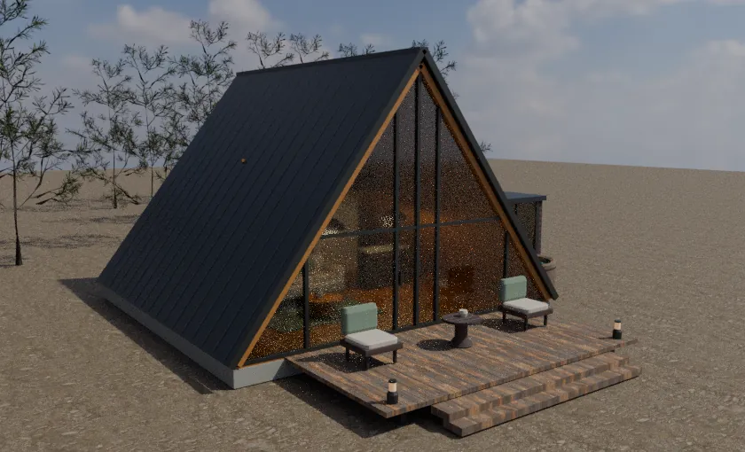
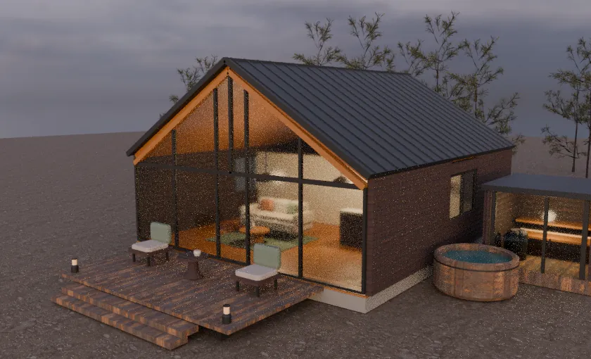

# Архитектурная визуализация Lake Village

## Аудит исходной сцены

Исходная версия проверена на коммите [00304fc](https://github.com/yaroslavkiri4ykknifhit-max/lakevillage/commit/00304fcf846b02607165ec532d28d95b04e1031a).

| Что ограничивало реализм | Изменение первого этапа |
|---|---|
| A-Frame был условной оболочкой шириной 10,6 м и высотой 11,8 м. Barnhouse также имел увеличенные условные пропорции. У A-Frame накладывались три поверхности стекла. | Два оригинальных Blender GLB в метрах. Отдельные стёкла, стойки и фрамуги, фасадные ламели, стоячие фальцы, торцы кровли, настил, ступени и спа-зона. В режиме «Кино» стекло использует преломление и отражения. |
| Код запрашивал карты из отсутствующей папки `assets/textures/`. | Локальные карты цвета, нормалей и шероховатости из Poly Haven и ambientCG. Основные материалы домов встроены в GLB. |
| Плоский участок, повторяющиеся ярусы хвои и жёсткая граница воды. Отдельный эллипс пляжа имел два смещения центра в разных системах координат. | Пологий рельеф и береговой склон, переход от лесного грунта к песку, ближние сосны, пихты, папоротники и мшистые камни. Дальние посадки сохраняют лёгкие силуэты. |
| Фон, отражения и источник света существовали независимо. Вода использовала условный цвет неба и концентрические кольца. | Два HDRI для фона и отражений в материалах, направленный источник согласован с яркой областью неба, отдельные тёплые светильники в домах и саунах. В режиме «Кино» отражённая камера показывает реальный берег, а шейдер добавляет рябь, зависимость отражения от угла и изменение цвета с глубиной. |
| В первом лице камера шла со скоростью 15,5 м/с, свободно проходила через берег и оставалась на фиксированной высоте. | Скорость 2,6 м/с снаружи и 1,55 м/с внутри, высота камеры связана с землёй и настилом, добавлены простые границы для воды и двух новых домов. Автотур плавно поднимается на длинных перелётах. |
| Сложные интерьерные детали создавались для всех 14 домов сразу. Отсутствовала детализация по дистанции. | Два детальных дома, инстансы растительности и камней, переключение ближнего леса с гистерезисом, начальное качество по ширине экрана и возможностям устройства, пауза рендера вне экрана и в режиме плана. GLB упакованы с WebP. В режиме «Быстро» отключаются тени, отражённая камера и преломление стекла. |

## Подтверждённые данные и допущения

Генплан из [презентации, стр. 6](../assets/Lake-Village-Investment.pdf#page=6) показывает A-Frame на левом берегу, Barnhouse на правом, пирс на центральной оси, оранжерею и ресторан у дальнего берега. Въезд, парковка, администрация, пляж, детская и вертолётная площадки остаются в тех же относительных позициях. Презентация содержит иллюстрацию без координатной сетки, геодезии и масштаба. Для демонстрационных домов сохранены центры и направления из исходного сайта.

| Объект | Данные источника | Выбор для модели |
|---|---|---|
| A-Frame 56 | Unit-Home указывает общие габариты 8 × 8,25 × 5,86 м, террасу 17,83 м², отдельную кухню, гостиную у панорамного стекла и спальню на антресоли. Таблица на той же странице отдельно приводит условное пятно 6 × 8 м. [Карточка производителя](https://unit-home.ru/aframe56) | Основной объём ориентирован на заявленные внешние габариты. Терраса 6 × 2,972 м. Точные проёмы, лестница, перегородки, сантехника и мебель разработаны для демонстрации. |
| Barnhouse 56 | Unit-Home указывает 8 × 9,6 м, террасу 16,8 м² и гостиную 19,7 м² со вторым светом. Карточка описывает одноэтажный вариант с двумя или тремя спальнями. Краткий каталог расходится с ней по этажности. [Карточка производителя](https://unit-home.ru/barn/barn56) · [Каталог](https://unit-home.ru/catalogbarn) | Использован одноэтажный вариант с тремя спальными зонами, террасой 5,6 × 3 м и принятым для визуализации коньком около 5,42 м. Планировка предварительная. |
| Сауны, мебель и отделка | В доступных материалах нет утверждённых спецификаций для этого участка. | Отдельные концептуальные сауны, купели, мебель и отделка показаны для обсуждения визуального направления. Габариты домов выше относятся к основным объёмам. |
| Оранжерея | Forest Dew показывает стеклянную площадку для мероприятий. [Архитектурный референс](https://forestdew.ru/) | Существующая концептуальная модель оранжереи сохранена для общего плана. Детальная реконструкция потребует фасадов, разрезов и схемы зала. |

## Проверка

- Blender 4.3.2 экспортировал две модели домов и четыре модели растительности и камней. Khronos glTF Validator проверил все шесть файлов без ошибок и предупреждений.
- Дневной A-Frame и вечерний Barnhouse отдельно отрендерены на CPU в Blender Cycles. Проверены силуэты, ориентация фасадов, прозрачность стёкол, читаемость мебели, террас и сауны. Это тест моделей в отдельной сцене.
- В Chromium проверены загрузка страницы и открытие генерального плана при отсутствии WebGL 2. Полный визуальный и интерактивный прогон 3D в браузере ожидает окружения с WebGL 2. FPS, мобильный GPU, отражения и освещение в реальном времени требуют отдельной проверки.
- В следующем проходе для точной привязки нужны геопривязанный DWG/DXF или IFC, топосъёмка и размерные планы, фасады и разрезы конкретных комплектаций домов. Первый проход по остальным зданиям целесообразно выполнить после визуальной проверки двух демонстрационных домов на устройстве с WebGL 2.

### Контрольные кадры Blender

| A-Frame 56, день | Barnhouse 56, вечер |
|---|---|
|  |  |

### Проверка на устройстве с WebGL 2

Откройте 3D-тур в Chrome, Safari или Firefox. По очереди откройте оба демонстрационных дома, проверьте фасад и вход в гостиную, пройдите по террасе и вдоль озера. Затем переключите день и вечер в обоих режимах качества, запустите автотур и сравните положение объектов с генпланом. Для контроля производительности достаточно записать время загрузки 3D, частоту кадров у дома и частоту кадров на общем плане на одном компьютере и одном телефоне.
